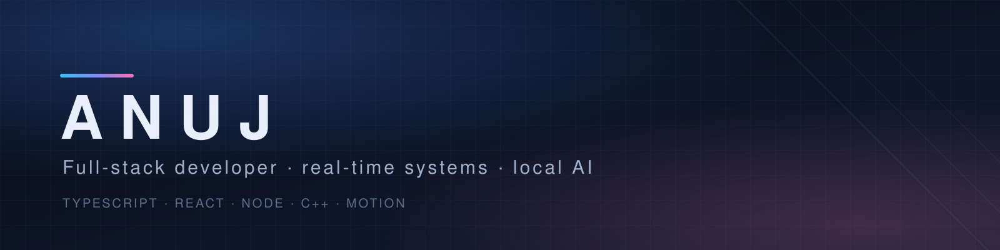

# Real-time products, local-first tools, and interfaces that feel considered

**Full-stack developer — TypeScript first, product-minded, comfortable down to the metal.**

I build web applications end to end: real-time multiplayer products, local-first tools, open-source packages, and frontends that lean hard on motion and craft. Most of what you see here started as a problem I wanted to solve properly rather than a tutorial I finished.

My favourite work is the part users never notice — sync protocols, streak engines, ranking systems, query layering, and animation timing that has to feel instant. When a browser isn't enough, I drop into C++ and write the kernels myself.

  
  
  

---

### 🛠 Stack

  
  
  
  
  
  
  

  
  
  
  
  
  
  

  
  
  
  
  
  

  
  
  
  

  
  
  
  
  
  
  

  
  
  
  

---

### 🔭 Selected work

| Project | What it does | Built with |
| --- | --- | --- |
| **[TypeDuel](https://github.com/qdexv/TypeDuel)** | Real-time multiplayer typing races, solo speed drills, ranked 1v1 duels and team lobbies. MIT licensed, with a maintained changelog and security policy. | React 18 · Vite · Socket.IO · Tailwind · TypeScript |
| **[Math Duel](https://github.com/qdexv/math-duel)** | 60-second mental-math duels with 5-second equations, combo streaks and ELO ranking. Custom WebSocket game engine. | Turborepo · React 19 · Prisma · PostgreSQL |
| **[ai-local-scratch](https://github.com/qdexv/ai-local-scratch)** | Dependency-free C++17 local LLM inference engine. Runs GGUF Llama-3 transformers entirely on CPU with hand-written AVX2+FMA quantization kernels — no GPU, no Python, no server. | C++17 · AVX2/FMA SIMD · GGUF |
| **[HabitFlow](https://github.com/qdexv/habit-tracker)** | Full-stack habit-tracking SaaS: JWT + bcrypt auth, streak engine, interactive calendar and analytics dashboards. | Next.js 16 · React 19 · SQLite · Recharts |
| **[Verdant](https://github.com/qdexv/verdant)** | Gamified habit tracker with schedule-aware streaks, a GitHub-style contribution forest and 17 milestone achievements. | React · Vite · Tailwind · Express · cron · MongoDB Atlas |
| **[LinkBio](https://github.com/qdexv/link-in-bio)** | Local-first link-in-bio creator: zero-config embedded SQLite, drag-and-drop page builder, themes and vector QR export — no cloud database. | Next.js 16 · TypeScript · node:sqlite |

**Also worth a look** · [stillform](https://github.com/qdexv/stillform), an editorial cinematic archive with kinetic typography and scroll-driven storytelling · [pdf-craft](https://github.com/qdexv/pdf-craft), a browser PDF editor with no feature gates · [telegram-vault-bot](https://github.com/qdexv/telegram-vault-bot), an encrypted file-vault bot on Postgres.

**IcoDeck** — an open-source icon package for developers, built to drop cleanly into different frameworks and package managers (npm: [`icodeck`](https://www.npmjs.com/package/icodeck)).

---

### 🎯 What I'm working on

- Making local AI usable without API keys, cloud quotas, or a GPU — the C++ inference engine is the long game here.
- Turning IcoDeck into something genuinely convenient to adopt across frameworks.
- Sharpening the boring-but-decisive parts of full-stack work: migrations, auth edge cases, deployment, and observable errors.
- Pushing web motion further — scroll choreography, 3D scenes, and interfaces that stay smooth under real data.

### 🧭 How I work

I learn by shipping, so prototypes become products instead of staying in a branches folder. I keep dependencies light and reach for the platform when it's enough. I care about the details that make software feel considered — empty states, latency, easing curves, and the difference between code that runs and code someone else can read.

I'm open to collaborating on open-source tools, real-time products, and anything that has to run offline.

---

  
  

<i>Build things. Break them properly. Understand why. Repeat.</i>
